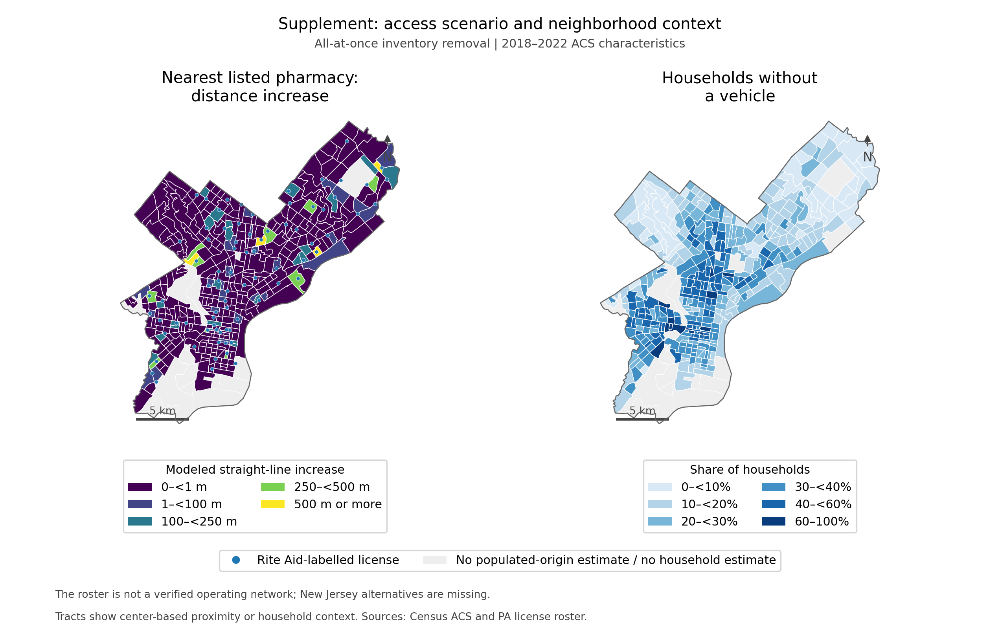

# Pharmacy Closures and Neighborhood Access in Philadelphia

**Accessibility, travel and equity in Philadelphia**  
Emmanuel Amissah Sampson · University of Pennsylvania · Urban studies research project

**Status: executed public-data feasibility pilot, with a research protocol for the 2023–2025 Rite Aid closures. This is not a completed causal evaluation.** The pharmacy roster is not a historical operating network, no licensed human-mobility data have been obtained, and no observed mode or emissions effects have been estimated.

Read the [project website](https://emmanuelsampson-prog.github.io/pharmacy-access-philadelphia/) for the illustrated write-up, or start with [the executed Jupyter notebook](notebooks/01_public_data_pilot.ipynb). It is the main research record. The [mobility and event-study notebook](notebooks/02_mobility_event_study.ipynb) documents the next stage and runs only when its verified inputs exist.



## Main findings

Removing Rite Aid-labelled license records simultaneously increases the population-weighted straight-line distance to the nearest listed pharmacy from **421.2 to 453.6 meters**. An increase occurs in **67 of 391 populated tracts**. Restricting the destination inventory to selected chain names produces a larger increase of **282.1 meters**, showing why the operating network needs verification.

These are spatial scenarios. The completed analysis does not establish a historical change in walking, driving or emissions. Closures could create longer car journeys; a conveniently located opening could replace a longer drive with a walk. Actual outcomes depend on travel responses, replacement services and usable routes.

Read the [full research report](docs/study_report.md), [Word submission report](outputs/public/Pharmacy_Access_Research_Report.docx) or [PDF report](outputs/public/Pharmacy_Access_Project_Brief.pdf) for the introduction, problem statement, methodology, results, discussion, recommendations, limitations and conclusion.

## The project

**Main research question:** How do pharmacy closures alter access to pharmacy destinations, redistribute visits to nearby alternatives, and change the potential travel burden borne by different neighborhoods?

Focus on Philadelphia and the 2023–2025 Rite Aid closures, with 2022 as the preperiod. The wider agenda—other stores, openings, relocations, travel modes and emissions—remains in the research protocol. Start with one sector and one city so that verifying events and assessing identification are feasible within a semester.

There are two different kinds of analysis:

1. **Executed public-data pilot:** Join ACS demographics to tract geography; compare proximity before and after removing Rite Aid-labelled entries from a licensed-pharmacy roster; evaluate a random forest against median and ridge baselines using contiguous spatial folds and a 1 km training buffer; calculate transparent emissions scenarios. These are modeled scenarios, not historical effects.
2. **Pending empirical study:** Reconstruct operating histories, obtain licensed aggregate mobility data, estimate cohort-time differences in outcomes with uncontaminated comparison areas, and study demand redistribution around remaining pharmacies. Actual travel modes require a suitable validated data source. Aggregated foot traffic alone does not identify mode.

## What is included

| File or directory | Purpose |
|---|---|
| `notebooks/01_public_data_pilot.ipynb` | Executed analysis, explanatory text, maps and outputs |
| `notebooks/02_mobility_event_study.ipynb` | Gated empirical analysis workflow and input requirements |
| `docs/research_protocol.md` | Questions, estimands, prediction, identification, spillovers and limitations |
| `docs/data_dictionary.md` | Fields, units, source limitations and required future inputs |
| `docs/data_access.md` | Penn/Dewey access and extraction instructions |
| `docs/references.md` | Linked primary sources and methodological references |
| `docs/github_publication.md` | Publication steps for `emmanuelsampson-prog` |
| `data/source_manifest.json` | Source URLs, retrieval times, SHA-256 hashes and extraction details |
| `data/processed/` | Public tract scenarios and unverified pharmacy candidates |
| `data/raw/` | Downloaded source inputs (in the downloadable package; ignored by Git) |
| `src/` | Reusable download, spatial analysis, ML, mobility, DiD and reporting code |
| `tests/` | Meaningful method checks; synthetic data exist only inside unit tests |
| `outputs/public/` | Figures, model comparisons, scenario results and project brief |
| `index.html` | GitHub Pages report, figures and emissions scenario explorer |
| `outputs/private/` | Future licensed-data outputs; excluded from Git |

## Reproduce the public pilot

Python 3.12 is the tested interpreter. On Windows, open PowerShell in the extracted repository:

```powershell
py -3.12 -m venv .venv
.\.venv\Scripts\Activate.ps1
python -m pip install -r requirements-lock.txt
python -m src.download
python -m src.pilot
python -m pytest -q
python -m ipykernel install --user --name pharmacy-access --display-name "Pharmacy Access"
```

On macOS/Linux, replace the first two commands with `python3.12 -m venv .venv` and `source .venv/bin/activate`. Open the notebooks in VS Code or Jupyter and select **Pharmacy Access**. If JupyterLab is not already installed, run `python -m pip install jupyterlab` and `jupyter lab`.

The downloadable package includes cached public analytical inputs, so the notebook can run offline. The optional insurer reference PDF is omitted; it is not needed for the calculations. A Git clone needs `python -m src.download` first. The downloader checks cached input hashes. Use `--refresh` only to intentionally fetch a new vintage, then inspect the changed provenance and results.

The supplied notebook cells were executed in order through IPython's in-process shell because this hosted runtime does not permit Jupyter kernel sockets. Their tables, images and printed outputs are captured from real execution. They remain standard Jupyter notebooks and can be rerun with a normal kernel on your computer. `python scripts/execute_notebooks.py` uses the normal kernel route; `--inprocess` reproduces the hosted execution route.

The Census API now requires a key; this project uses the official **bulk ACS Summary File** instead. It streams six national tables (approximately 505 MB in total), retains only the 408 Philadelphia tract records in each, and records the full-response and subset checksums. Allow several minutes and an adequate connection for a new download. No Census API key is needed for this public bulk route.

## Interpretation limits

- The Pennsylvania portal reports a July 1, 2025 update, but its rows may include nonretail, inactive or closed pharmacies. A name match is not proof of an operating store or a closure date.
- The scenario removes all Rite Aid-labelled entries from that roster at once. It does **not** identify which stores closed in each year or reconstruct a counterfactual 2023 network.
- Distances are from geometric tract centroids in meters, using EPSG:26918. They are straight-line proximity measures, not road distances, walking routes or observed trips.
- PA alternatives within 10 km of Philadelphia are included. New Jersey pharmacy locations are missing; 50 populated tract centers within 2 km of NJ are flagged. They remain in the main maps and descriptive results; only the secondary prediction comparison excludes them, leaving 341 tracts. The separate nonborder descriptive mean is 30.3 meters. This screen does not correct all cross-border bias.
- The all-listed and chain-name scenarios are inventory sensitivities, **not** formal lower and upper bounds.
- Population and household weights use 2018–2022 ACS estimates. Area-level differences do not identify individual behavior; MOEs are retained but are not propagated into pilot scenario results.
- The ML target is a mechanically calculated scenario. Its predictive accuracy is a feasibility demonstration; it does not establish causal effects or validate historical pharmacy status.
- Emissions are conditional gasoline-vehicle tailpipe CO2 scenarios per 1,000 hypothetical person round trips, not estimates of total city emissions or lifecycle CO2e.

## Historical evidence audit

The [third executed notebook](notebooks/03_closure_evidence_audit.ipynb) audits two court-filed lists: 101 Pennsylvania and New Jersey locations, including 16 Philadelphia sites that match the study roster. Eleven city sites were listed in an October 2023 motion and five in a June 2025 notice. These filing dates are **not** verified pharmacy closure dates. The [audit note](docs/evidence_audit.md) explains the extraction, address matching and remaining NJ coverage gap. The original spatial results remain unchanged.

To re-extract the public court PDFs, install Poppler (`pdftotext`) and run `python -m src.evidence --download`. The notebook itself uses the included factual CSV and does not require PDF software. The PDFs are not redistributed in the package.

## Toward the final empirical submission

Read [the research protocol](docs/research_protocol.md) and [data access instructions](docs/data_access.md). The essential next inputs are verified pharmacy operating intervals, and an authorized Penn/Dewey mobility extract. Do not upload API keys, raw device traces or licensed source data to GitHub. The repository excludes the restricted-input and private-output folders by default.

Repository: [emmanuelsampson-prog/pharmacy-access-philadelphia](https://github.com/emmanuelsampson-prog/pharmacy-access-philadelphia). GitHub Pages serves the root `index.html` from `main`. Regenerate the narrative and website after changing outputs:

```bash
python scripts/report_content.py
python scripts/build_website.py
python scripts/create_notebooks.py
python scripts/create_evidence_notebook.py
python scripts/execute_notebooks.py
```

The shared narrative in `scripts/report_content.py` also builds the Word and PDF reports. In an environment with `python-docx` and a LibreOffice installation, run `python scripts/build_submission.py` and `python scripts/build_brief.py`. The PDF keeps its original filename so previously shared links continue to work. The PDF export requires LibreOffice on PATH or `--office PATH`. Document formatting dependencies are separate from the pinned scientific analysis environment.

## Reuse

Original code is provided under the [MIT license](LICENSE). Third-party data retain their own terms; the code license does not relicense those data. See [references and attribution](docs/references.md).
