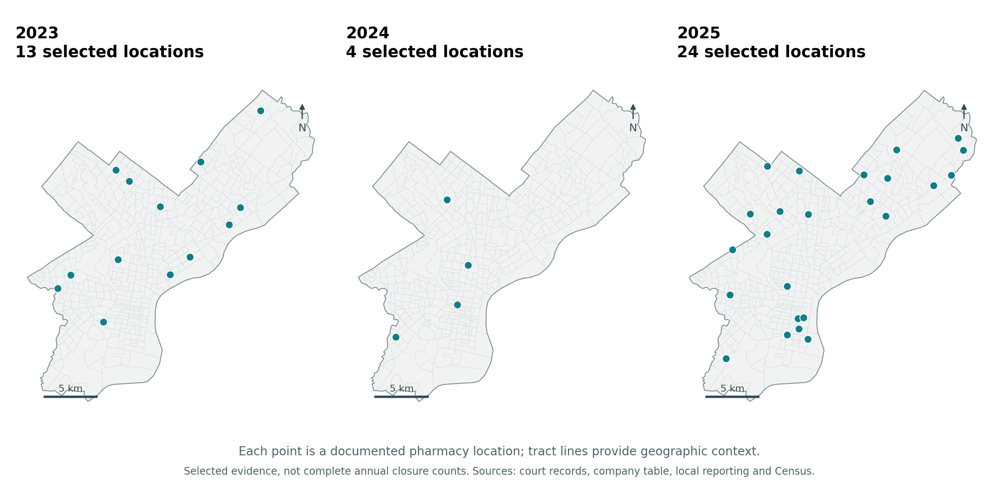
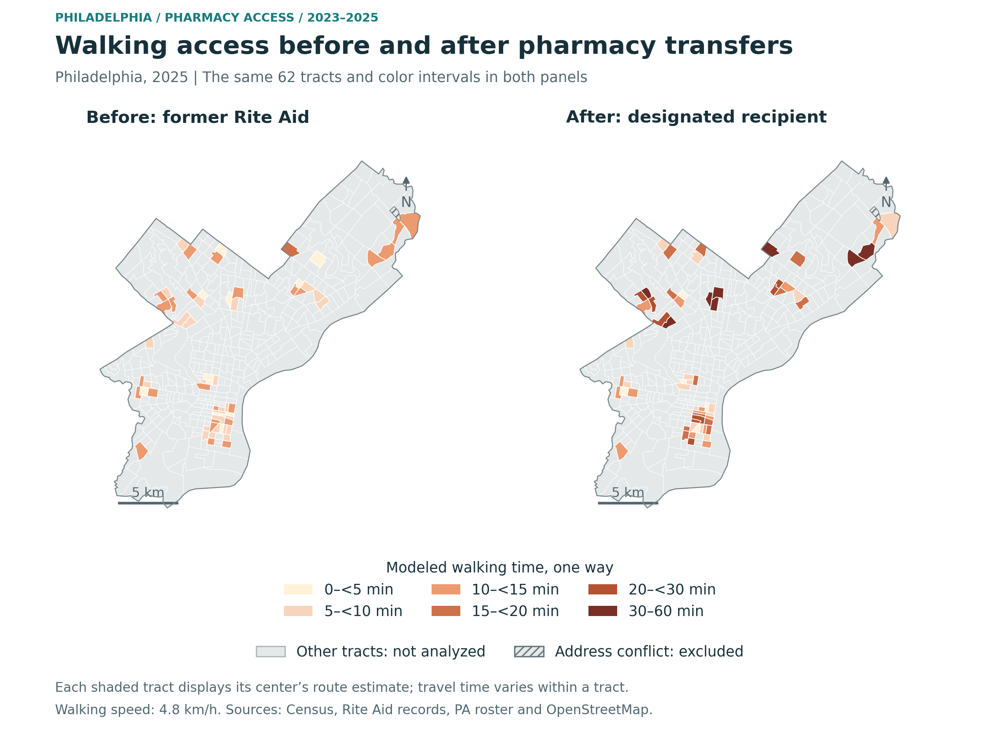

# Pharmacy Closures and Access in Philadelphia 2023–2025

Emmanuel Amissah Sampson · University of Pennsylvania

**A documented historical investigation and completed before-and-after accessibility assessment, with a protocol for estimating actual travel effects.** The project combines selected closure evidence from 2023–2025 with a focused study of designated prescription transfers in 2025. Observed journeys, mode changes and causal emissions effects remain unestimated.

Read the [illustrated research website](https://emmanuelsampson-prog.github.io/pharmacy-access-philadelphia/) or start with the [main executed Jupyter notebook](notebooks/04_before_after_transfer_access.ipynb). The [academic Word report](outputs/public/Pharmacy_Access_Research_Report.docx) contains the introduction, problem statement, methods, findings, discussion, recommendations and limitations. [Markdown report](docs/study_report.md) · [PDF report](outputs/public/Pharmacy_Access_Project_Brief.pdf) · [Reproducible download](https://github.com/emmanuelsampson-prog/pharmacy-access-philadelphia/releases/latest)



## What was established

- **41 selected Philadelphia locations** are documented across 2023–2025. The ledger distinguishes court notices, scheduled retail closures, reported pharmacy dates and designated transfers. It is not a complete citywide closure census.
- **24 company-reported transfers** have final pharmacy days between **June 4 and August 8, 2025**. All 24 store numbers also occur in an insurer directory updated May 5, 2025; five appear in the selected June court notice. These checks corroborate identities and closure selection, not every exact closing day.
- **62 tract origins** meet the primary route rules and represent 22 transfers. The Academy Road address conflict is excluded; Krewstown Road has no tract center within the main catchment. One transfer keeps the same address.
- Population-weighted **modeled walking time rises from 9.0 to 16.0 minutes** one way. Modeled **driving distance rises from 1.61 to 2.75 km** per round trip. These are routes to former and designated receiving pharmacies from fixed tract centers—not observed journeys or effects on all Philadelphia residents.
- A declared scenario gives **142.19 kg additional gasoline tailpipe CO₂ per 1,000 hypothetical round trips** at 50% car share and 100% additional travel. It holds mode share constant and does not estimate a walking-to-driving transition.



## Follow the visual story

The report contains **ten figures**: three yearly evidence maps; the 2025 event timeline; former-to-recipient destination links; before/after walking tract choropleths; a separate walking-change tract map; paired walking/driving comparisons; walking thresholds and the distribution of changes; a location-level comparison; neighborhood equity comparisons; and conditional emissions sensitivity. The website adds an **interactive weekly timeline**, **transfer explorer** and **emissions calculator**. Select a week in the timeline to inspect its pharmacy addresses and designated recipients. Every figure states what its values represent. Access maps shade eligible tracts using their center-based estimate; gray means no primary estimate. Maps of pharmacy events retain point symbols and use tract boundaries for context.

The dated timeline shows **18 of 24 records in July (75%)**, with **seven in 21–27 July**. Weekly counts use Monday–Sunday bins and retain zero-record weeks. These are counts in the selected company table, not all Philadelphia closures. The print figure pairs weekly bars with individual date markers. Download its [SVG](outputs/public/transfer_timeline.svg), [PDF](outputs/public/transfer_timeline.pdf), [weekly counts](outputs/public/transfer_timeline_weekly.csv) or [daily counts](outputs/public/transfer_timeline_daily.csv). Rebuild this figure alone with `python -m src.timeline`.

Maps and statistical charts share one [figure style](docs/figure_style.md): DejaVu Sans, a common export width, consistent title and label sizes, and a defined teal/rust palette. Before/after colors agree across destination maps and comparison charts. Sequential and diverging maps retain scales appropriate to their measures. The scatterplot diagonals mark equal values; they are not fitted regression lines.

The investigation period is **2023–2025**. The numerical route comparison is a **2025 subset**, not a three-year outcome panel. The proposed causal study would use **January 2022–December 2025**, with 2022 as a baseline. Neighborhood characteristics use **2018–2022 ACS** estimates, and both route scenarios use the **January 1, 2025** historical street network.

## Research records

| Record | Purpose |
|---|---|
| [Notebook 04](notebooks/04_before_after_transfer_access.ipynb) | Main executed historical evidence, corroboration and routed before/after study |
| [Notebook 01](notebooks/01_public_data_pilot.ipynb) | Supplementary all-at-once inventory-removal and spatial prediction exercise |
| [Notebook 02](notebooks/02_mobility_event_study.ipynb) | Input-gated mobility and cohort-time DiD workflow; no empirical effects yet |
| [Notebook 03](notebooks/03_closure_evidence_audit.ipynb) | Court records and license-inventory audit |
| [Before/after methods](docs/before_after_methods.md) | Assignment, routes, exclusions, weighting and interpretation |
| [Research protocol](docs/research_protocol.md) | Spatial DiD and spillovers; conditions for geographic RDD or spatial IV |
| [Data access](docs/data_access.md) | Required authorized mobility extract and mode information |
| [Data dictionary](docs/data_dictionary.md) | Fields, units and limitations |
| [References](docs/references.md) | Sources, provenance and attribution |
| `data/*manifest.json` | Retrieval details, source URLs, input hashes and network vintage |
| `data/processed/` | Public factual ledgers and derived access results |
| `outputs/public/` | Ten main figures, supporting results and final reports |
| `src/`, `scripts/`, `tests/` | Reusable analysis, publication code and method checks |

## Reproduce the analysis

Python 3.12 is the tested interpreter. The [release package](https://github.com/emmanuelsampson-prog/pharmacy-access-philadelphia/releases/latest) includes cached public analytical inputs and derived historical graphs. It is the easiest offline starting point. A Git clone excludes raw inputs and needs the downloads below.

On Windows PowerShell:

```powershell
py -3.12 -m venv .venv
.\.venv\Scripts\Activate.ps1
python -m pip install -r requirements-lock.txt
python -m ipykernel install --user --name pharmacy-access --display-name "Pharmacy Access"
python -m pytest -q
```

On macOS/Linux, use `python3.12 -m venv .venv` and `source .venv/bin/activate` for the first two commands. Select **Pharmacy Access** in Jupyter or VS Code. If needed, install JupyterLab with `python -m pip install jupyterlab`.

For a Git clone, acquire the original inputs before running notebook 04:

```bash
python -m src.download
python -m src.pilot
python scripts/download_historical_networks.py
python -m src.transfer_access
```

The Census bulk downloader streams approximately 505 MB across six national tables and retains the Philadelphia subset. It requires no Census API key. The network builder downloads a 296 MB historical Pennsylvania OSM extract and can require several GB of RAM. The cached release graphs avoid that build. The included factual transfer and corroboration CSVs allow route analysis without re-extracting source webpages or PDFs.

To re-extract and review the historical sources:

```bash
python -m src.evidence --download
python -m src.transfers --download
python -m src.corroboration --download
python scripts/build_historical_evidence.py
```

The court and insurer extractors require Poppler's `pdftotext`. The raw PDFs, company archive and national OSM PBF are not redistributed in the package. Source manifests record provenance; review any changed source or address match before accepting refreshed results. The Census geocoder response used for Knights Road is cached.

To regenerate all notebooks and publications:

```bash
python scripts/create_notebooks.py
python scripts/create_evidence_notebook.py
python scripts/create_transfer_notebook.py
python scripts/execute_notebooks.py
python scripts/report_content.py
python scripts/build_figure_fonts.py
python scripts/build_website.py
```

The supplied notebooks capture real ordered execution through IPython's in-process shell because hosted kernel sockets are unavailable. `python scripts/execute_notebooks.py --inprocess` reproduces that route. They remain standard Jupyter notebooks. The full notebook run can take several minutes and requires adequate memory for the network graphs.

The Word/PDF builders use a separate presentation environment with `python-docx` and LibreOffice: `python scripts/build_submission.py` and `python scripts/build_brief.py`. The PDF retains its original filename to preserve existing links.

## How to interpret the findings

The after destination is the **designated prescription recipient**, not necessarily the pharmacy each patient chose. Origins are geometric tract centers, not homes. Population weights represent neighborhood context, not customer counts. Walking time assumes 4.8 km/h. Routes hold the January 2025 mapped network fixed, include screened straight connectors and omit complete turn restrictions and node barriers. No transit routes or actual travel speeds are estimated.

The earlier inventory-removal supplement reports a 32.4 m weighted straight-line increase across 391 populated tracts. It uses a different sample, inventory and destination rule; it is not directly comparable to the paired-route result. Its 50 near-New-Jersey tracts remain in descriptive maps and are excluded only from the secondary prediction comparison because New Jersey alternatives are missing. That screen does not determine inclusion in the main transfer study.

The primary causal strategy is staggered **spatial difference-in-differences**, with separate direct and spillover exposures. A geographic RDD requires a real boundary-based assignment discontinuity; none has been established here. A spatial IV requires a defensible relevant, exogenous instrument and exclusion restriction; none has been established here. No method is labelled as an estimated causal result without its required data.

Actual travel effects require an authorized aggregate mobility panel, complete operating/replacement histories and appropriate comparison areas. Foot-traffic counts alone do not reveal whether people walked or drove. Validated mode observations or travel-survey evidence are needed for mode changes and net emissions. See [the precise data request](docs/data_access.md).

## Reuse and attribution

Original code is [MIT licensed](LICENSE). Census and PA sources retain their stated public-data terms. **OpenStreetMap-derived network data are © OpenStreetMap contributors, ODbL 1.0**, supplied through Geofabrik; the MIT code license does not relicense these databases. Source articles and insurer PDFs retain third-party copyright. Restricted mobility data, API credentials and private outputs are excluded from GitHub.
