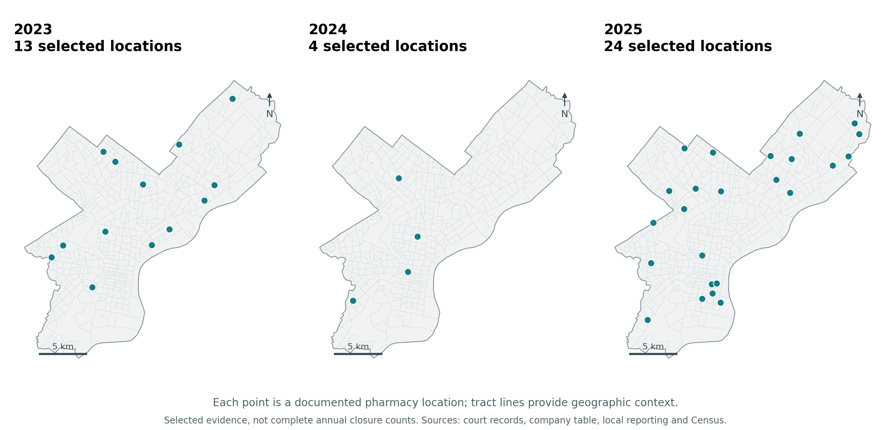
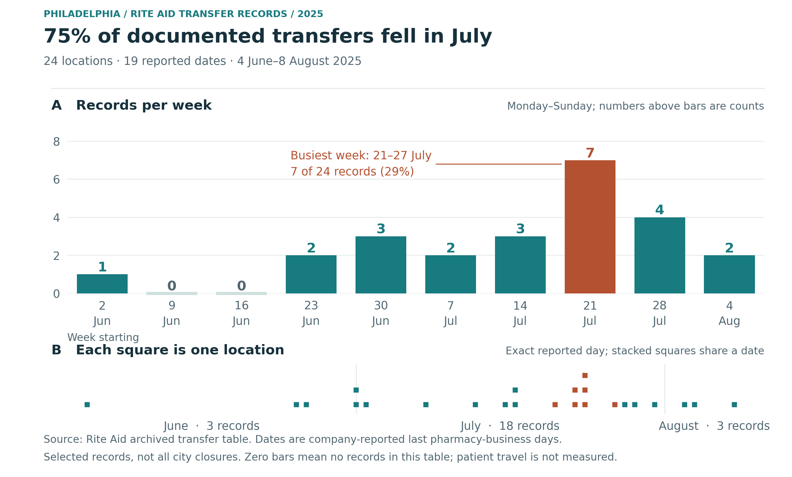
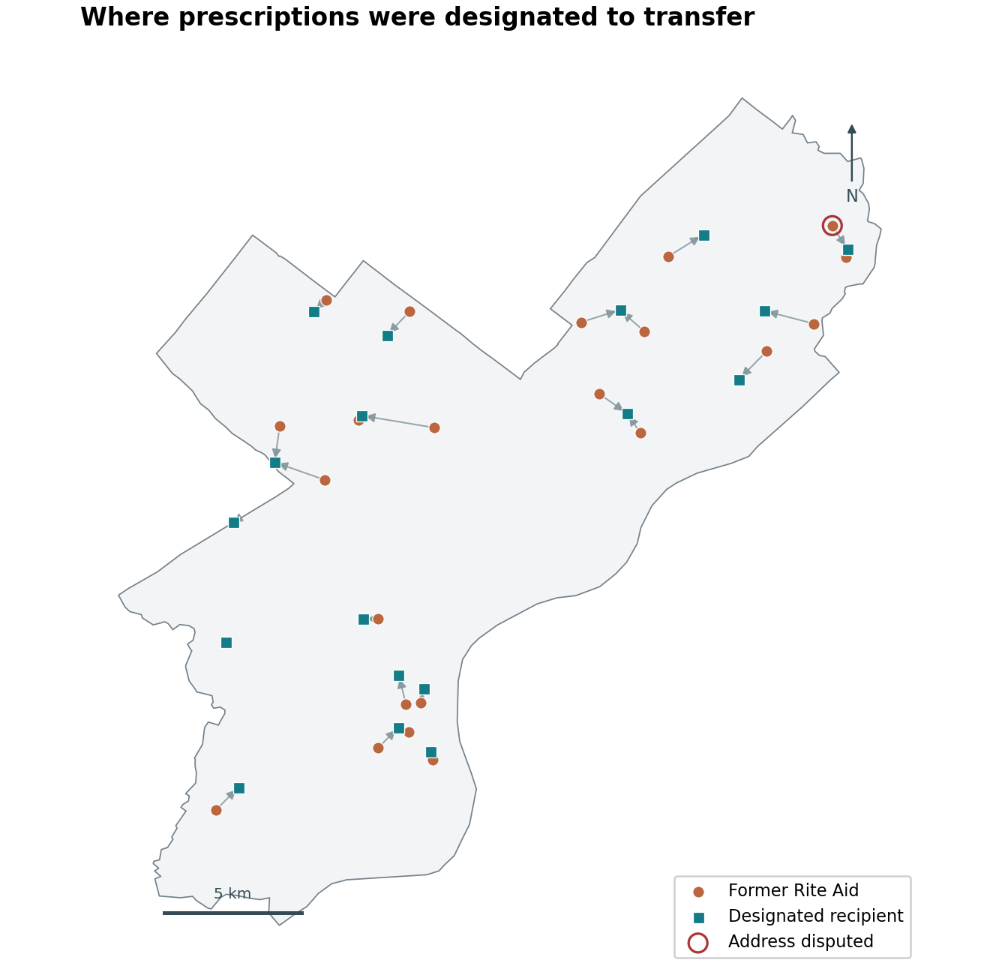
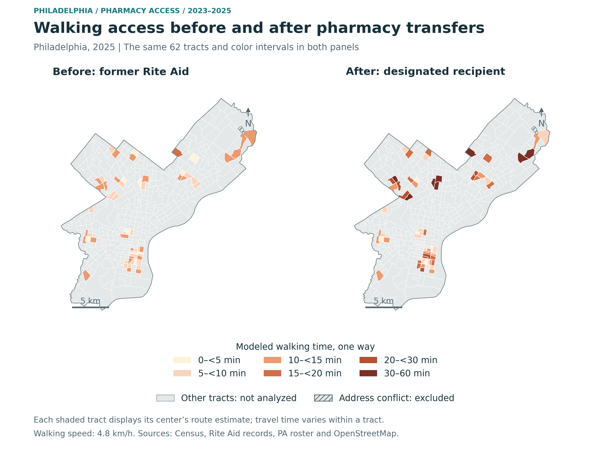
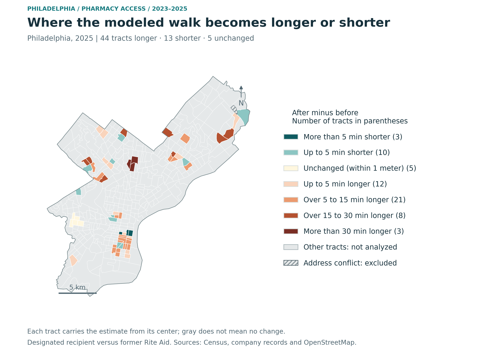
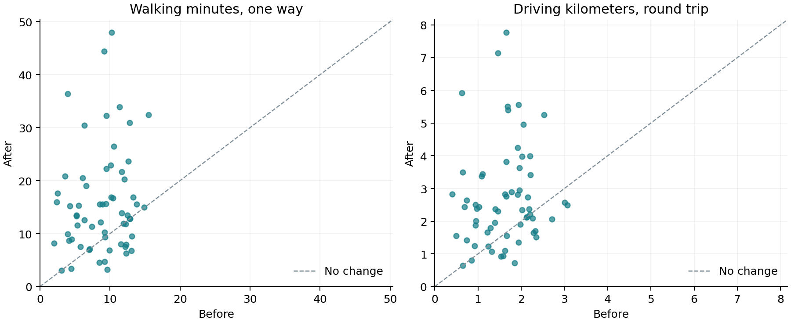
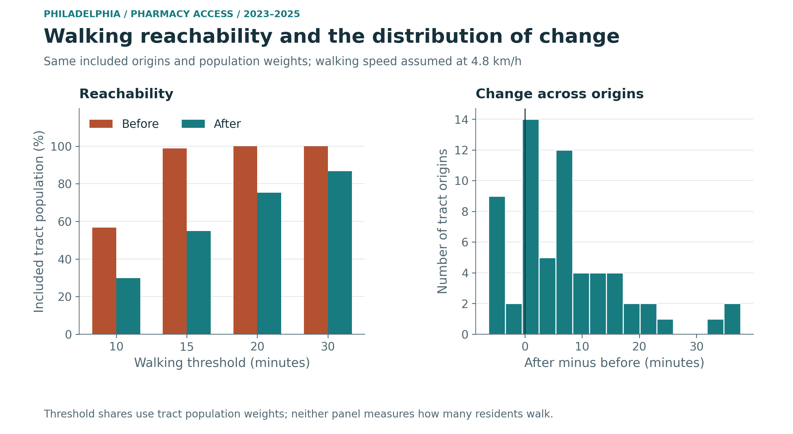
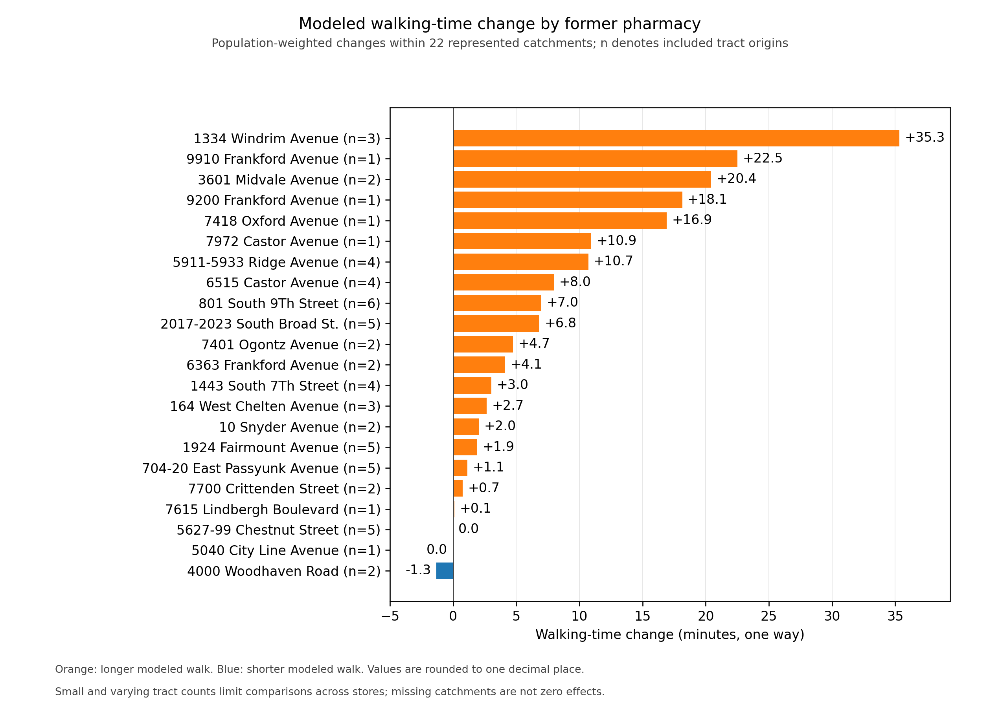
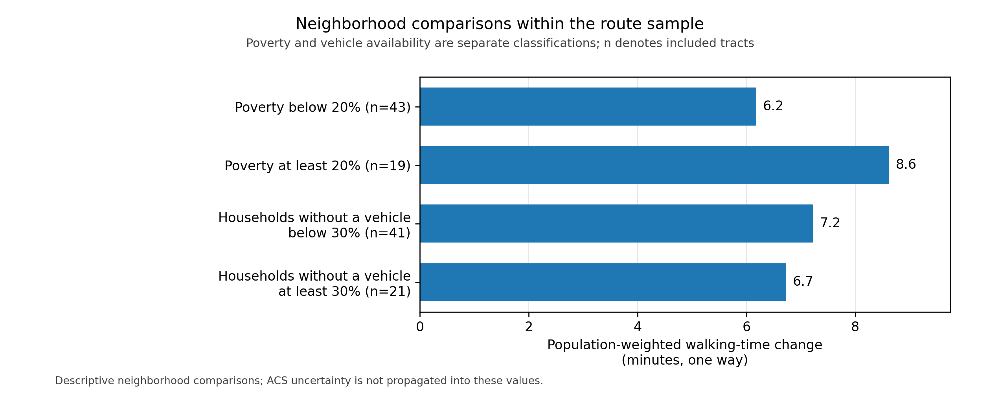
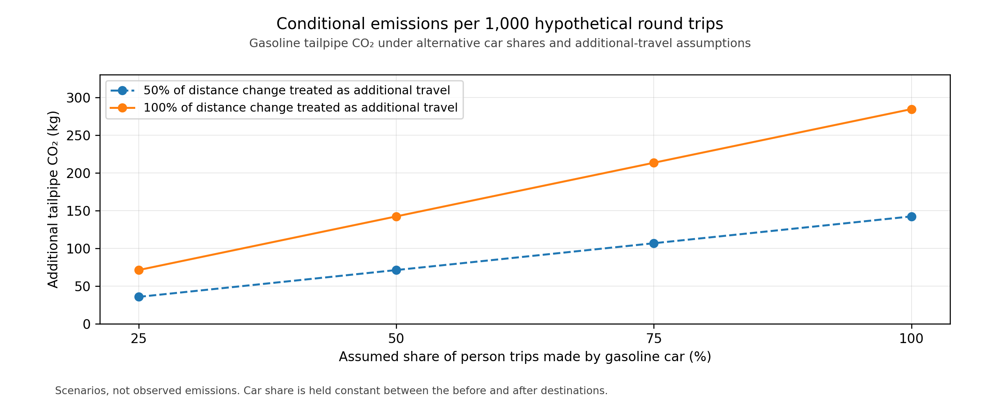

# Pharmacy Closures and Access in Philadelphia 2023–2025

Historical evidence and before and after access with a research design for travel and emissions

Emmanuel Amissah Sampson · University of Pennsylvania · 16 November 2026

## Abstract

This study investigates Rite Aid closures and pharmacy access in Philadelphia during 2023–2025. A source ledger documents 41 selected city locations, distinguishing court notices, reported pharmacy closing dates and prescription transfers. An archived company table identifies 24 transfers in 2025. All 24 store numbers also appear in an insurer directory dated May 5, 2025, although the exact closing days have not been independently verified for every site. A before-and-after destination comparison uses a fixed historical street network and nearby Census tract centers. Among 62 eligible origins, population-weighted modeled walking time rises from 9.0 to 16.0 minutes; driving distance for a round trip changes from 1.61 to 2.75 kilometers. These results quantify access to designated receiving pharmacies under stated assumptions. They do not estimate how many residents changed destinations or travel modes. Conditional emissions calculations and a spatial difference-in-differences protocol connect this completed accessibility assessment to the broader question of travel behavior. Observed journey and causal emissions effects remain unestimated because an authorized mobility panel and validated mode information are not available.

## Introduction

Commercial location decisions have implications for the communities in which firms operate. In the case of pharmacies, a closure may alter the distance residents travel to obtain prescriptions and the transport options available to them. Residents may respond by walking farther, using public transport, arranging a car journey or obtaining medicines through delivery. An opening may improve access where its location and services meet local needs. The relationship between commercial location and access therefore requires attention to both the distribution of pharmacies and the circumstances of the households they serve.

Against this background, the study examines Rite Aid closures and pharmacy access in Philadelphia during 2023–2025. City Council raised concerns about the loss of pharmacy services, whilst contemporaneous reporting described the adjustments residents made following closures [4, 22]. The analysis draws on these historical records and compares routes from the same residential-area origins to former pharmacies and their designated prescription recipients. This provides a basis for examining how the reorganisation of pharmacy services may change the practical burden of obtaining medicines.

Existing research has examined the distance between closing pharmacies and designated prescription recipients at the national level [16]. This study extends that discussion through a local analysis of access from residential-area origins, taking account of the mapped walking and driving networks. Particular attention is given to the quality of the historical evidence and to differences between neighborhoods. The contribution is a documented assessment of destination access in Philadelphia, together with a research design for subsequently examining actual journeys and emissions. The route calculations establish the former; observed travel data are still required for the latter.

## Study period and evidence coverage

The investigation period is January 2023–December 2025. Evidence coverage varies within that period. The complete three-year mobility study would use 2022 as a preclosure baseline; those observations have not yet been acquired. The shorter 2025 transfer window is a focused component of the wider historical investigation, not a substitute for three years of outcome data.

Table 1. Time periods used in this study

| Component | Period | What it represents |
| --- | --- | --- |
| Historical investigation | 2023–2025 | 41 selected Philadelphia locations in closure evidence |
| Dated transfer comparison | June 4–August 8, 2025 | 24 company-reported final pharmacy operating days |
| Street network | January 1, 2025 | One mapped network held constant for both destinations |
| Neighborhood characteristics | 2018–2022 | ACS five-year estimates, held fixed |
| Proposed mobility panel | 2022–2025 | Planned baseline and follow-up; not yet obtained |

Figure 1. Locations in the selected 2023–2025 evidence ledger. The 2023 panel contains 13 locations, the 2024 panel four, and the 2025 panel 24. Years describe the documented closure episode; records differ in date precision. These are not complete annual closure counts. Sources: court records, local reporting and archived company table; coordinates from the PA license roster.

## Problem statement and research questions

The central problem is that a change in pharmacy provision is easier to document than its consequences for residents. A licensing record may remain after a pharmacy stops operating, and a planned closure date may differ from the final dispensing day. A prescription-transfer record identifies a designated recipient, but it does not establish that every customer subsequently used that pharmacy. If these differences are overlooked, an accessibility measure may misrepresent the destinations available to residents, whilst a causal analysis may assign the intervention to the wrong period.

The study therefore asks how access from nearby residential areas differs between a former pharmacy and its designated recipient, and whether this difference is greater in neighborhoods facing particular transport or economic constraints. It then considers the conditions under which additional distance would translate into longer walks, additional driving and higher emissions. A further objective is to specify how observed closure effects could be separated from declining demand, neighborhood sorting and changes at nearby surviving pharmacies. Openings form a related extension of this agenda; an opening panel is not available for the present analysis.

## Historical evidence and corroboration

The broader ledger contains 11 Philadelphia sites listed in an October 2023 court motion, two additional 2023 episodes reported locally, four reported pharmacy dates in 2024, and 24 dated transfers in 2025. The 2023 Aramingo record gives a scheduled store-closing day, which is not treated as a pharmacy-stop day. The Grays Ferry record establishes an autumn 2023 closure episode without an exact pharmacy date. The 2024 records cover Chestnut Street, North Broad Street, Germantown Avenue and Woodland Avenue [11, 19–23].

Rite Aid’s archived transfer table supplies store numbers, former addresses, reported last pharmacy-business days and designated receiving pharmacies [13]. It contains 1,025 national rows and 326 Pennsylvania/New Jersey rows. The analysis uses the 24 rows whose former location is Philadelphia. Twenty-three identify a recipient at another address; the Chestnut Street record names Unity Pharmacy at the same address. A same-address transfer is not proof of an uninterrupted service transition.

Table 2. What the additional sources corroborate

| Check | Result | Interpretation |
| --- | --- | --- |
| May 5 insurer directory | 24 of 24 store numbers matched | Corroborates listed provider identity before the transfer window |
| Selected June 6 court notice | 5 of 24 sites matched | Corroborates closure selection, not the final pharmacy day |
| Independent local reporting | Eastwick date is consistent | Staff interview gives July 24; branch-address link is inferred |
| Repeated company-table reporting | Chestnut August 8 matches | Same underlying source; not independent date verification |
| Address review | 1 unresolved conflict | Academy Road is listed as 12353 by the insurer and 12311 elsewhere |

The insurer directory lists 34 Philadelphia Rite Aid locations, so the 24 transfer records do not cover every site listed before the final closure wave [14]. The directory may itself lag operating changes. The selected court notice adds evidence for five locations [12]. July reporting distinguishes pharmacy closure from the later closing of the retail store and notes that the company’s online list was incomplete [17]. August reporting corroborates the regional wind-down, but not every store’s exact day [18]. No exact-address operating date is labelled independently confirmed in the audit.

Figure 2. Timing of the 24 documented transfers. Bars count locations by Monday–Sunday week using company-reported last pharmacy-business days. July contains 18 records (75%); the busiest week, 21–27 July, contains 7. The underlying dates are retained for each location. Zero bars mean no records in this selected table, not zero closures citywide. These counts do not measure patient journeys. Source: archived Rite Aid transfer table [13].

Figure 3. Former pharmacies and their designated prescription recipients. Arrows connect paired addresses; they are not street routes or observed journeys. The disputed Academy Road location is marked for review and excluded from the primary route calculations. A purple outline marks the same-address Chestnut transfer; faint tract lines provide geographic context. Sources: company table, PA pharmacy coordinates and Census boundaries.

## Methodology

### Origins and destination pairs

The study uses populated Census tract centers as standardized residential-area origins, with fixed 2018–2022 ACS population and household characteristics [2, 3]. Each origin is assigned to its nearest former pharmacy among the 24 documented transfer locations. The main catchment includes origins within 800 meters in straight-line distance. This assignment prevents duplicate origins where catchments overlap; it does not identify actual customers or imply that the assigned pharmacy was their nearest pharmacy of any brand.

The before destination is the former Rite Aid. The after destination is the recipient named in its transfer record. Both routes start from the same origin and use the same street network. Other pharmacies, delivery, insurance restrictions and patient choice are not modeled. Thus the comparison estimates access to a particular documented transfer destination, rather than the nearest available alternative or a causal change in actual journeys.

### Historical network and route calculation

Tract centers are calculated after projecting boundaries to NAD83 / UTM zone 18N (EPSG:26918), in meters; planar catchments and maps use the same projection. Stored geographic coordinates use WGS84 (EPSG:4326). Network routes sum street-edge lengths and great-circle node-connector distances in meters, never planar distances in degrees.

Walking and driving networks are built from Geofabrik’s Pennsylvania OpenStreetMap extract containing mapped data through January 1, 2025 at 21:21 UTC [15]. The extraction covers Philadelphia, the receiving destination in Bala Cynwyd and a surrounding margin. Mode-specific road permissions and driving direction are applied. Routes minimize distance. Traffic, intersection delay, turn restrictions, conditional restrictions and complete node-level barrier permissions are not represented.

Address points and tract centers are connected to nearby network nodes by short straight segments. These connectors are approximations and are recorded separately. The main sample rejects origins if any endpoint-to-node connection exceeds 200 meters, if an outbound or return route is unreachable, or if the assigned former address is unresolved. Store 1956 on Academy Road is excluded because its insurer address conflicts with the company, court and license-roster address; including it is reported as a sensitivity.

Walking minutes assume a constant 4.8 km/h and omit waiting, slopes and individual mobility limitations. Driving round trips are calculated in both directions to account for one-way streets; the code does not simply double the outbound distance. Of 63 candidate origins within 800 meters, 0 have an unreachable route, 0 fail the endpoint-distance screen, and 1 is assigned to the disputed address. Exclusion reasons can overlap. The final common sample contains 62 origins linked to 22 transfers.

### Weighting and sensitivity

Population-weighted means give greater weight to origins representing more residents. They do not count observed pharmacy users or weight by actual visits. Descriptive equity comparisons use a 20% neighborhood poverty threshold and a 30% threshold for households without a vehicle. Catchment radii of 500, 800 and 1,000 meters and maximum connector lengths of 100, 200 and 300 meters test sensitivity to spatial choices. The main sample holds origins and population weights constant between before and after.

## Results of the before and after comparison

The 62 included tract origins represent an ACS population context of 262,710; this is not a count of affected customers. Their population-weighted modeled one-way walk rises from 9.0 minutes to 16.0 minutes, an increase of 7.1 minutes. The corresponding driving round trip changes from 1.61 to 2.75 kilometers, a difference of 1.14 kilometers.

Figure 4. Before-and-after walking access shown as census-tract choropleths. The same 62 tracts use identical color intervals in both panels. Each shaded tract carries its geometric center’s route estimate, not a measurement for every resident or point in the tract. Gray tracts are outside the primary sample; hatching marks the excluded address conflict. The after destination is the designated recipient. Sources: Census, PA pharmacy coordinates, company table and OpenStreetMap contributors.

Figure 5. Change in modeled walking time from the same tract center, after minus before. Blue shades indicate shorter journeys to the designated recipient and orange shades indicate longer journeys. The unchanged category allows a one-meter distance tolerance, matching the reported counts. Gray denotes no primary estimate, not zero change. Colors describe center-based estimates rather than uniform access across each tract.

Table 3. Population-weighted access in the common sample

| Measure | Before | After | Change |
| --- | --- | --- | --- |
| One-way walking distance in km | 0.72 | 1.28 | +0.56 |
| One-way walking time in minutes | 9.0 | 16.0 | +7.1 |
| Driving round trip in km | 1.61 | 2.75 | +1.14 |

Walking distance increases by more than one meter at 44 origins, decreases at 13, and is unchanged within one meter at 5. A designated recipient can be closer to a particular origin than the former store, so decreases are possible. This differs from removing a destination and always choosing the nearest remaining option, where distance cannot decrease by construction.

Figure 6. Each point compares one origin before and after its assigned transfer. Dashed diagonals indicate equal values, not fitted regression lines. Points above the diagonal have longer modeled access after transfer; points below it have shorter access. Walking minutes are one-way; driving kilometers include separately routed outward and return journeys. No mode change is inferred from these plots.

Figure 7. The left panel reports the population-weighted share of included tract origins within each walking threshold; it assumes every tract resident is represented at the tract center. The right panel shows the distribution of walking-time differences across origins. Neither panel measures the share of residents who actually walk.

The largest location-level increase occurs among the three included origins assigned to 1334 Windrim Avenue: their population-weighted walking time rises by 35.3 minutes when the destination becomes 112 West Chelten Avenue. Two origins assigned to 4000 Woodhaven Road have a small average decrease. The same-address Chestnut transfer leaves modeled distance unchanged. These comparisons describe selected catchments; their small and varying tract counts limit comparisons across stores.

Figure 8. Mean walking-time change within each represented former-store catchment, using fixed tract population weights. Labels give the number of included origins. Twenty-two transfers are represented: Academy Road is excluded for its address conflict, and Krewstown Road has no tract center within the main catchment. Missing estimates are not zero effects.

## Neighborhood differences

A given additional distance can matter differently to households with and without a vehicle. The following comparisons describe the route sample and its neighborhood composition. They do not estimate an individual resident’s burden or establish statistically significant causal differences.

Figure 9. Population-weighted walking-time change by neighborhood group. Poverty and vehicle availability are separate classifications, so the same origin appears in one group within each pair. Labels show tract counts. ACS uncertainty is not propagated into these descriptive values.

Table 4. Descriptive neighborhood comparisons

| Group | Tracts | Walking change in minutes | Driving round-trip change in km |
| --- | --- | --- | --- |
| Poverty below 20% | 43 | 6.2 | 1.01 |
| Poverty at least 20% | 19 | 8.6 | 1.38 |
| Households without a vehicle below 30% | 41 | 7.2 | 1.15 |
| Households without a vehicle at least 30% | 21 | 6.7 | 1.12 |

The higher-poverty group has a larger modeled walking increase (8.6 versus 6.2 minutes), while the group with more households without a vehicle has a slightly smaller increase (6.7 versus 7.2 minutes). The data therefore do not support a blanket claim that every disadvantaged group experiences a larger distance increase. The group differences should guide closer examination of routes, service availability and transport options. A small geographic change can still be difficult for someone with restricted mobility or an incompatible insurance plan. Conversely, neighborhood poverty alone cannot establish which pharmacy a resident used or how they travelled.

## Walking, driving and emissions

The route comparison shows whether reaching the designated recipient would require a longer walk or drive from a fixed origin. It does not identify a switch between walking, driving or transit. A longer walking route may make walking less practical, but the response could be another pharmacy, delivery, a combined errand or a forgone visit. An opening could support walking when it replaces a longer journey and offers usable pedestrian access; a car-oriented opening could also attract additional driving.

There is qualitative evidence that some Philadelphia residents changed travel after earlier closures. Reporting on the Grays Ferry closure describes former short walks being replaced by bus journeys, borrowed cars and paid rides, and some collection being combined with other appointments [22]. These published interviews corroborate plausible travel mechanisms. They are not a representative mobility sample, and their reported experiences are not treated as this project’s measured average effect.

### Conditional carbon calculation

The emissions scenario uses the modeled driving round-trip difference of 1.14 km and the EPA approximation of 400 grams of tailpipe CO₂ per gasoline-vehicle mile [6]. Assuming 1,000 hypothetical person round trips, half made by gasoline car, one traveler per vehicle and all of the route difference counted as additional travel gives 142.2 kg of additional tailpipe CO₂. The route distances already include both directions, so no extra doubling or detour multiplier is applied.

Figure 10. Conditional tailpipe emissions using the route-sample weighted driving-distance change. Each line changes the assumed share of that difference that creates additional travel; the horizontal axis varies the assumed car share. These are scenarios, not observed carbon outcomes or confidence intervals.

This simplified calculation holds the car share constant between before and after. It cannot measure emissions from a walking-to-driving transition. A full account would compare mode-specific travel before and after and include occupancy, trip chaining, delivery, vehicle mix and transit operations. Emissions could increase with additional driving, but a drop caused by people forgoing needed care would not represent improved accessibility.

## Discussion

The findings suggest that the location of the receiving pharmacy deserves attention alongside the closure itself. Within the study sample, designated transfers are associated with a longer modeled walk on average, although the direction and size of the change vary across origins. This variation matters for policy: a transfer arrangement that is geographically convenient for one residential area may be less convenient for another. The comparison incorporates the mapped street layout, but its interpretation remains conditional on patients using the designated recipient and on the use of tract centers to represent residential origins.

The source review also shows why the quality of the underlying records is central to an access assessment. All 24 store numbers match a pretransfer insurer directory, strengthening confidence in provider identity. However, the Academy Road address conflict remains unresolved and is carried through the analysis as an exclusion and sensitivity check. At Chestnut Street, the designated recipient occupies the same address as the former Rite Aid. The withdrawal of a chain should therefore not automatically be interpreted as the permanent disappearance of pharmacy services from that location.

There is a further issue of repeated displacement. Reporting on the 2023 Grays Ferry closure describes prescriptions moving to another Rite Aid that subsequently appears in the 2025 transfer table [22, 13]. A receiving pharmacy may consequently absorb demand after one closure and later become a closure location itself. This has implications for the proposed event study, since such a pharmacy cannot be assumed to remain an unaffected comparison throughout the period. Direct exposure, transferred demand and subsequent closures would need to be followed together.

The supplementary inventory-removal exercise addresses a different question. It gives a population-weighted straight-line increase of 32.4 meters across all 391 populated tracts when all listed alternatives are retained, compared with 282.1 meters under the selected chain-name inventory. The difference illustrates the importance of defining the available destination set. These estimates use a different sample and destination rule from the paired-route analysis, and hence do not provide a direct comparison with its results.

## Socio-econometric identification strategy

The causal stage asks whether changes following a closure exceed changes that would otherwise have occurred. Neighborhood sorting, falling store demand and firm selection of closure sites can affect both exposure and outcomes. Spatial socio-econometric methods can help address these problems when their identifying assumptions are credible. Merely adding spatial terms to a regression does not isolate a treatment effect.

### Spatial difference in differences

The primary design is a staggered difference-in-differences analysis with explicit spatial exposure. A 2022–2025 origin-by-period panel would compare changes around 2023–2025 closures with changes in never-treated or not-yet-treated origins. Direct exposure, demand received by nearby surviving pharmacies, and overlapping later closures would be modeled separately. Cohort-specific contrasts avoid using already-treated areas as controls [7, 8]. Pretrends, anticipation, panel coverage and common support must be assessed; bankruptcy alone does not randomize store locations or closure timing.

The initial spatial specification uses an 800-meter direct catchment and an 800–1,600-meter indirect ring, with alternative distances and preclosure visit-based catchments. Nearby receiving pharmacies are potential spillover outcomes rather than automatically valid controls. The Python notebook contains an unadjusted cohort-time estimator and input checks; the optional R script documents a covariate-adjusted extension. Neither has produced empirical closure effects without the required mobility data.

### Geographic regression discontinuity

A spatial RDD would be appropriate only if a documented policy or eligibility rule changed closure or replacement exposure discontinuously across a geographic boundary. School-district or municipal boundaries can support such designs in other settings, but no qualifying assignment rule has been identified for these Rite Aid closures. Residential sorting, simultaneous policy differences, river barriers and spillovers can invalidate the comparison. The PA–NJ border is therefore not used as an instrument or causal cutoff in this study [24].

### Spatial instrumental variables

An instrumental-variable design would require a variable that predicts closure exposure while affecting pharmacy travel only through that exposure, with a credible exogeneity argument. A spatial lag, historical store density, distance to a pharmacy or lease timing does not automatically satisfy that exclusion restriction. No valid instrument has been established here. If one is found, the study should report its first stage, weak-instrument diagnostics, the population whose effect is identified, and the implications of spatial interference [25].

## Recommendations

The access results provide a basis for selecting locations for further service and route assessment. Priority should be given to origins with substantial modeled increases, with household vehicle availability considered alongside those increases. Before a particular receiving pharmacy or replacement site is recommended, the assessment should establish its capacity, opening hours, insurance acceptance and accessible entrances, as well as the practicality of walking and public-transport connections.

A dated local pharmacy register would improve the evidence available for this work. Such a register should distinguish dispensing operations from the retail front end, record designated prescription recipients and follow successor pharmacies at the same address. The Academy Road conflict requires resolution, whilst final operating days should be checked against independent sources where possible. A more complete analysis of alternative destinations should also include independent pharmacies and relevant New Jersey locations.

The next empirical stage requires an authorised aggregate mobility extract covering January 2022–December 2025. It should retain closed locations, stable destination identifiers, origin distributions and information on panel coverage. Foot-traffic records can support an analysis of visitation and destination choice, but they do not by themselves identify whether a journey was made on foot or by car [9]. Mode information or a suitable travel survey is therefore required before estimating changes in walking, driving or net emissions.

Pharmacy openings should be examined as a separate intervention, using documented opening dates and a relevant comparison group. The practical question is whether a new location shortens usable journeys and provides services that nearby residents can access, while accommodating demand. The present study provides no estimate of an opening effect; the same attention to operating dates, destination choice and transport conditions would be required for that extension.

## Limitations

The historical ledger is selective. It spans 2023–2025 but is not a balanced three-year panel or a complete closure census. The numerical before-and-after route comparison covers only the 2025 transfer subset. Company-reported final business days are distinguished from independent verification, and scheduled dates may differ from actual execution. The current evidence cannot establish a citywide historical treatment effect.

Designated prescription recipients need not be the pharmacies patients ultimately chose. The 800-meter catchment, nearest studied former-site assignment and geometric tract centers approximate exposure. The fixed January 2025 map may omit later changes; mapped walkability does not guarantee a safe or accessible route. Node connectors, approximate addresses, missing turn restrictions and incomplete barrier information introduce measurement error. Transit journeys are not routed.

The paired study includes PA origins and designated recipients, not every potential alternative. New Jersey destinations could matter in a complete choice set. In the older nearest-pharmacy supplement, 50 tracts near New Jersey remain in descriptive results but are excluded from its prediction comparison because the destination inventory omits New Jersey. That screen is unrelated to the primary paired-route inclusion rule.

ACS estimates describe 2018–2022 neighborhoods; their margins of error are retained but not propagated. Population weights do not measure customers, pharmacy trips or treatment exposure for individual residents. No confidence intervals or causal subgroup claims are attached to the descriptive comparisons. No licensed mobility panel, validated mode observations or local emissions measurements have been obtained. The carbon calculations depend on declared assumptions and omit wider transport and lifecycle effects.

## Conclusion

This study examined pharmacy access in Philadelphia through selected historical evidence from 2023–2025 and a focused comparison of designated prescription transfers in 2025. It assembled the historical records, corroborated the identities of 24 former Rite Aid locations and compared access to former and receiving pharmacies from the same residential-area origins. Among the eligible origins, the population-weighted modeled walk increases by 7.1 minutes and the driving round trip by 1.14 km. The spatial distribution of these changes indicates where designated transfers may warrant closer attention to service availability and transport support.

The implication is that continuity of prescription records alone is insufficient to establish continuity of convenient access. The location and services of the recipient, together with residents’ transport options, remain relevant to the assessment. At the same time, the findings cannot establish how many residents changed travel modes or the net emissions attributable to the closures. Addressing those questions requires the proposed mobility panel and spatial difference-in-differences analysis. The contribution of the present study is the documented access comparison and the empirical groundwork for that further investigation.

## References

1. Pennsylvania Department of State and Department of Health. Find Naloxone at a Pharmacy Near Me Current Statewide. Dataset ysdx-4vmi; portal update July 1, 2025. [Source](https://data.pa.gov/Opioid-Related/Find-Naloxone-at-a-Pharmacy-Near-Me-Current-Statew/ysdx-4vmi/about_data)

2. U.S. Census Bureau. 2022 American Community Survey five-year Summary File. Tables B01001, B01003, B03002, B08201, B17001 and B19013; estimates cover 2018–2022. [Source](https://www.census.gov/programs-surveys/acs/data/summary-file.2022.html)

3. U.S. Census Bureau. 2022 Cartographic Boundary Files. Pennsylvania census tracts and United States counties at 1:500,000 scale. [Source](https://www.census.gov/geographies/mapping-files/time-series/geo/cartographic-boundary.html)

4. Philadelphia City Council. Resolution 240071. Pharmacy closures and access concerns. [Source](https://phila.legistar.com/LegislationDetail.aspx?ID=6503447&GUID=E7438EA1-5E3E-460A-9902-FCDE7D12D48B&FullText=1)

5. U.S. Environmental Protection Agency. Smart Growth and Transportation. Access to destinations and transportation choices. [Source](https://www.epa.gov/smartgrowth/smart-growth-and-transportation)

6. U.S. Environmental Protection Agency. Greenhouse Gas Emissions from a Typical Passenger Vehicle. Approximately 400 grams of tailpipe CO₂ per gasoline-vehicle mile. [Source](https://www.epa.gov/greenvehicles/greenhouse-gas-emissions-typical-passenger-vehicle)

7. Callaway, B., and Sant’Anna, P. H. C. (2021). Difference-in-Differences with Multiple Time Periods. Journal of Econometrics, 225(2), 200–230. [Source](https://doi.org/10.1016/j.jeconom.2020.12.001)

8. Butts, K. Difference-in-Differences Estimation with Spatial Spillovers. Working paper, arXiv:2105.03737. [Source](https://arxiv.org/abs/2105.03737)

9. Penn Libraries (2025). Penn Data Access Unlocked via Dewey Platform. May 21. [Source](https://www.library.upenn.edu/lippincott/datapoints/data-access-dewey-2025)

10. AmeriHealth Caritas Pennsylvania and Community HealthChoices (2025). Rite Aid pharmacy closure notice. June 5. Contextual evidence of closures and prescription transfers; not a store-specific event ledger. [Source](https://www.amerihealthcaritaschc.com/content/dam/amerihealth-caritas/acpchc/pdf/provider/resources/communications/2025/20250605-rite-aid-pharmacy-closure-notice.pdf.coredownload.inline.pdf)

11. Rite Aid Corporation et al. (2023). Store closing sales motion. U.S. Bankruptcy Court, District of New Jersey, case 23-18993-MBK, document 37, filed October 16. Exhibit A Schedule 1, PDF pages 54–56. Public mirror of court-filed document. [Source](https://cdns.abclocal.go.com/three/kabc/101823-kabc-rite-aid-doc.pdf)

12. New Rite Aid LLC et al. (2025). Sixth notice of additional closing locations. U.S. Bankruptcy Court, District of New Jersey, case 25-14861-MBK, document 743, filed June 6. Exhibit 1, PDF pages 5–8. Public mirror of court-filed document. [Source](https://npr.brightspotcdn.com/f8/c8/faad678e424db35665a541d7ce0a/25-06-06-store-closure-filing.pdf)

13. Rite Aid (2025). Pharmacy Closure and Transfer List. Internet Archive capture October 4, 2025; 1,025 national rows. [Source](https://web.archive.org/web/20251004155916/https://content.riteaid.com/new-pharmacy-location.html)

14. Keystone First VIP Choice (2025). Pharmacy Directory. Updated May 5, 2025. Philadelphia Rite Aid entries, printed pages 105–108. [Source](https://q1.keystonefirstvipchoice.com/content/dam/keystone-first/vip-choice/pdf/2025-pharmacy-directory.pdf.coredownload.inline.pdf)

15. OpenStreetMap contributors and Geofabrik (2025). Pennsylvania historical extract, January 1, 2025. ODbL 1.0. Network filtering and checksums are documented in the repository. [Source](https://download.geofabrik.de/north-america/us/pennsylvania.html)

16. Veeramachaneni, S., Ramachandran, S., and Barnard, M. (2026). Bulk Prescription Transfers and Access After Chain Pharmacy Closures. JAMA Health Forum, 7(7), e262070. [Source](https://doi.org/10.1001/jamahealthforum.2026.2070)

17. McCarthy, E. (2025). Philly’s last Rite Aid stores will close in late August. The Philadelphia Inquirer, July 9. [Source](https://www.inquirer.com/business/rite-aid-philadelphia-stores-closing-20250709.html)

18. McCarthy, E. (2025). All Rite Aid pharmacies are officially closed in Pa., N.J. The Philadelphia Inquirer, August 23. [Source](https://www.inquirer.com/business/health/rite-aid-pharmacies-closed-pennsylvania-new-jersey-20250823.html)

19. Ajamu, R. (2024). Rite Aid to close its Germantown Avenue location. Resolve Philly, April 16; updated July 17. [Source](https://resolvephilly.org/gih/rite-aid-to-close-its-germantown-avenue-location-leaving-some-residents-without-a-nearby-pharmacy/)

20. McCarthy, E. (2024). Six more Rite Aid stores are closing in Philly and its suburbs. The Philadelphia Inquirer, April 8. [Source](https://www.inquirer.com/business/rite-aid-closures-philadelphia-chester-county-south-jersey-20240408.html)

21. Perez-Castells, A. (2024). Another Center City Rite Aid is closing as the company continues to downsize amid bankruptcy. The Philadelphia Inquirer, January 8. [Source](https://www.inquirer.com/business/rite-aid-pharmacy-closed-center-city-20240108.html)

22. McCarthy, E. (2024). What happens after a Philly neighborhood’s last chain pharmacy shuts its doors. The Philadelphia Inquirer, February 4. [Source](https://www.inquirer.com/business/rite-aid-bankruptcy-south-philadelphia-20240204.html)

23. Perez-Castells, A. (2023). More Rite Aid pharmacies are closing in the Philadelphia region before the end of the year. The Philadelphia Inquirer, December 1. [Source](https://www.inquirer.com/business/rite-aid-store-closed-phamacy-bankruptcy-20231201.html)

24. Keele, L. J., and Titiunik, R. (2015). Geographic Boundaries as Regression Discontinuities. Political Analysis, 23(1), 127–155. [Source](https://doi.org/10.1093/pan/mpu014)

25. Angrist, J. D., Imbens, G. W., and Rubin, D. B. (1996). Identification of Causal Effects Using Instrumental Variables. Journal of the American Statistical Association, 91(434), 444–455. [Source](https://doi.org/10.1080/01621459.1996.10476902)
